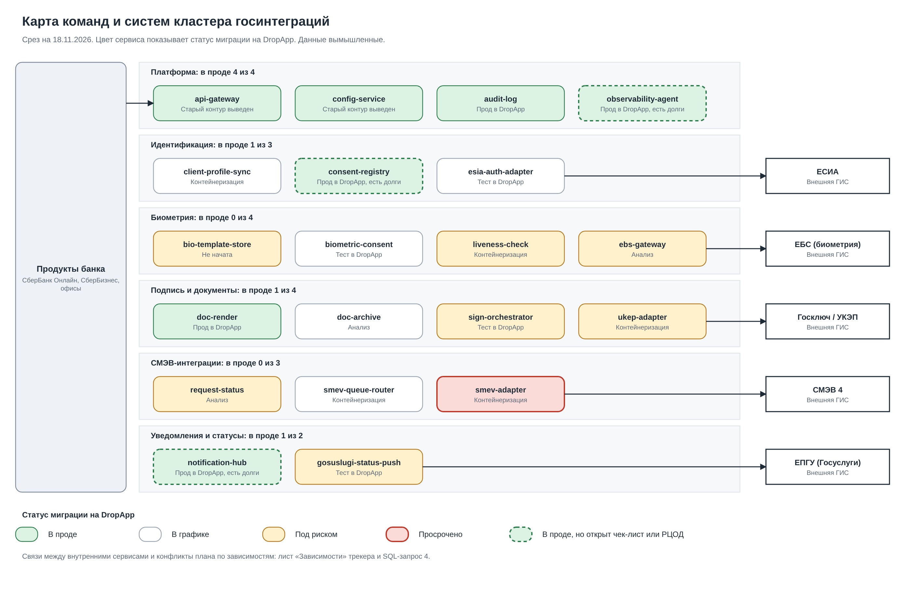
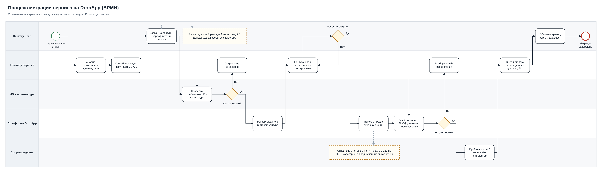

# Delivery-kit кластера госинтеграций

Я собрал этот проект к отклику на стажировку Delivery Lead. Хотел показать, как понимаю эту работу: не просто вести трекер и протоколы, а замечать, где план расходится с реальностью, раньше, чем это превратится в просрочку.

Кластер вымышленный. В нём 6 команд и 20 микросервисов: они связывают продукты банка с ЕСИА, ЕБС, СМЭВ, Госключом и ЕПГУ и переезжают на контейнерную платформу DropApp. Команды, сервисы, даты и цифры придуманы, настоящие только названия государственных систем.

## Что видно на срезе 18.11

Ради этого всё и собиралось, поэтому начну с выводов.

1. **Неделя хорошая, темп нет.** За неделю +2 сервиса в проде и +9,5 п.п. готовности. Но в среднем за три недели получается 5,7 п.п. и один сервис в неделю. При таком темпе к последнему окну изменений 18.12 не успеваем ни по одной метрике. А срок программы 25.12 вообще попадает в новогодний мораторий.
2. **Две метрики дают разные даты.** По готовности всё закончится к 12.01, по числу сервисов в проде к 17.02. Первые этапы дешёвые, поэтому готовность обгоняет реальность. Я бы ориентировался на вторую дату.
3. **Риск есть и там, где его не назвали.** Под риском 7 сервисов, а блокер назван у пяти. sign-orchestrator и request-status третью неделю стоят на месте. Если бы статус ставили руками, оба были бы «в графике».
4. **«В проде» ещё не значит «готово».** Из 7 сервисов в проде до конца доведены 4. consent-registry вышел в прод, не пройдя учения по переключению на РЦОД, и в трекере это никак не мешало выходу. После разбора я добавил готовность РЦОД в чек-лист выхода.
5. **Команды не снимут блокеры сами.** Четыре блокера висят дольше 10 рабочих дней, и все упираются в ИБ, платформу и внешние согласования.

**Что предлагаю:** разделить программу на две волны. Первая идёт до 18.12. В неё попадают 4 сервиса без блокеров, у которых зависимости уже в проде или в этой же волне. Это как раз нынешний темп, и к мораторию в проде будет 11 из 20. Остальные 9 сервисов уходят во вторую волну, после 11.01. Состав волн трекер считает сам. Подробнее в [дайджесте](digest/2026-W47_digest.md).

## Что внутри

| Задача из вакансии | Где смотреть |
|---|---|
| Карта команд и систем | [`diagrams/cluster_map`](diagrams/cluster_map.png), исходник в draw.io (открывается и в Visio) |
| Трекер миграции на DropApp | [`tracker/delivery_tracker.xlsx`](tracker/delivery_tracker.xlsx): листы «Миграция DropApp», «История этапов», «Динамика», «Чек-лист выхода», «Зависимости» |
| Статус развёртывания РЦОД | Лист «РЦОД» трекера и [разбор неуспешных учений](docs/razbor_ucheniy_consent-registry.md) |
| Встречи с руководителями групп | [Протокол 18.11](meetings/2026-11-18_vstrecha_RG.md), [шаблон](meetings/template.md), [задачи для импорта в Jira](jira/jira_import.csv) |
| Еженедельный дайджест | [PowerPoint](digest/2026-W47_digest.pptx) и [текст](digest/2026-W47_digest.md), черновик собирается из трекера |
| Процессы | [Регламент](docs/reglament.md): роли (RACI), условия перехода между этапами, чек-лист выхода, эскалация, окна изменений, учения |
| BPMN | [Процесс миграции одного сервиса](diagrams/migration_bpmn.png) |
| SQL | [9 запросов с результатами](sql/results.md), в том числе на оконных функциях |

## Как я считаю статус и почему так

- **Статус не ставится руками.** «Зелёный» статус обычно держится до последнего дня, поэтому трекер считает его сам. Сервис под риском, если у него назван блокер, или зависимость ещё не в проде и выходит не раньше его самого, или он три недели и дольше стоит на одном этапе.
- **Прод это 90%, а не 100%.** Пока жив старый контур, работа не закончена и банк платит за два контура. Две недели держим ради отката, всё, что дольше, попадает в дайджест.
- **Эскалация зависит от возраста блокера.** До 5 рабочих дней решает команда, до 10 встреча РГ, дальше руководитель кластера. И всегда с конкретной просьбой, а не просто «нет доступа».
- **Окна и мораторий входят в расчёт.** Если прогноз попадает в мораторий, реальная дата считается от первого дня после него.

Пороги (3 недели, 5 и 10 дней, 2 недели) я выбрал сам, на реальной команде их надо обсуждать.

## Что я бы спросил у команды в первую неделю

1. Что считается «сервис в проде»: переключён весь трафик или его часть? От этого зависит, с какого дня отсчитывать две недели до вывода старого контура.
2. Кто решает, что блокер снят: команда или тот, от кого он зависит, например ИБ или платформа?
3. Есть ли у DropApp общий план выделения ресурсов (GPU, квоты), или каждая команда просит сама?
4. Бывают ли исключения из моратория для госинтеграций, например когда регулятор меняет формат сведений СМЭВ?
5. Где сейчас живёт правда о статусе: в Jira, Confluence или в Excel у каждого РГ? Трекер имеет смысл, только если он один.

## Карта команд и систем



Цвет показывает статус миграции. Пунктирная рамка означает, что сервис в проде, но у него открыт пункт чек-листа или РЦОД.

## Процесс миграции сервиса



## Трекер

| Лист | Что там |
|---|---|
| Сводка | Дата среза, показатели, прогноз, готовность по командам |
| Динамика | Готовность и сервисы в проде по неделям, темп, прогноз с учётом моратория |
| Миграция DropApp | Этап, план, блокер и его возраст, сигналы риска, статус, эскалация, факт выхода, старый контур |
| РЦОД | Развёртывание в резервном ЦОД, учения, RTO |
| Чек-лист выхода | 7 пунктов и РЦОД по каждому сервису, «Прод с долгами» |
| Зависимости | Проверка конфликтов плана |
| История этапов | Пять недельных срезов, из них считается застой на этапе |
| Календарь | Окна изменений, мораторий, учения, регламентные работы ГИС |
| Задачи | Решения встречи РГ |
| Как пользоваться | Как обновлять раз в неделю за 10–15 минут и как считается статус |

Синий текст вводится руками, чёрный считается формулами, зелёный ссылается на другие листы.

## Как запустить

```bash
pip install openpyxl
npm install pptxgenjs playwright
python scripts/build.py      # трекер, база SQLite и запросы, протокол, задачи Jira, дайджест в Markdown
python scripts/diagrams.py   # карта и BPMN: draw.io и PNG
node scripts/digest_pptx.js  # дайджест в PowerPoint
```

Исходные данные лежат в `data/*.csv`. Если поменять этап, дату или блокер, все артефакты пересоберутся.

## Ограничения

- Данные вымышленные. В жизни трекер жил бы в Jira и Confluence, а Excel был бы выгрузкой. Здесь Excel и SQLite, чтобы всё открывалось без доступа к корпоративным системам.
- Прогноз линейный, по трём последним неделям. Для 20 сервисов сложнее не нужно: важно понять порядок отставания, а не угадать день.
- Праздники в рабочих днях не учитываются.
